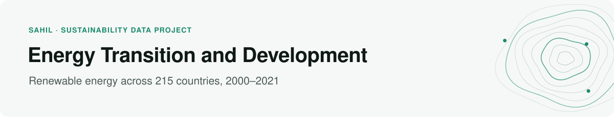
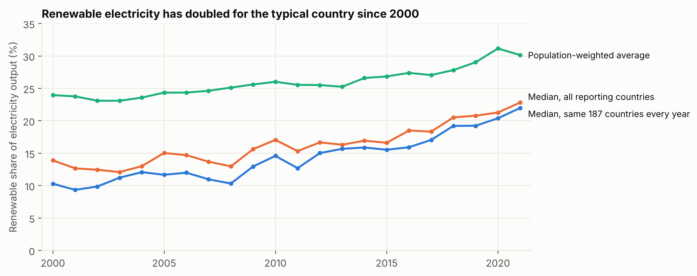
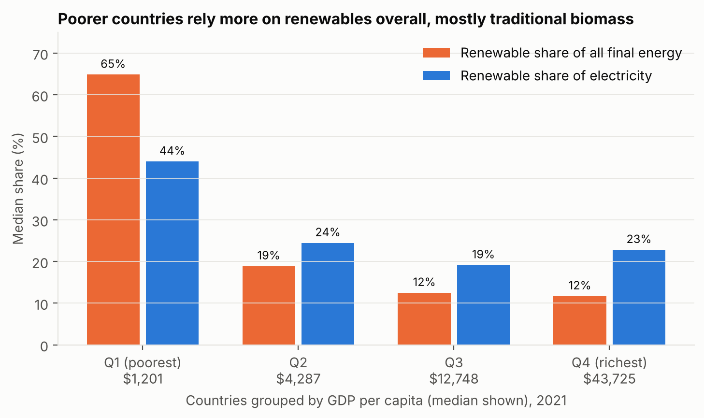
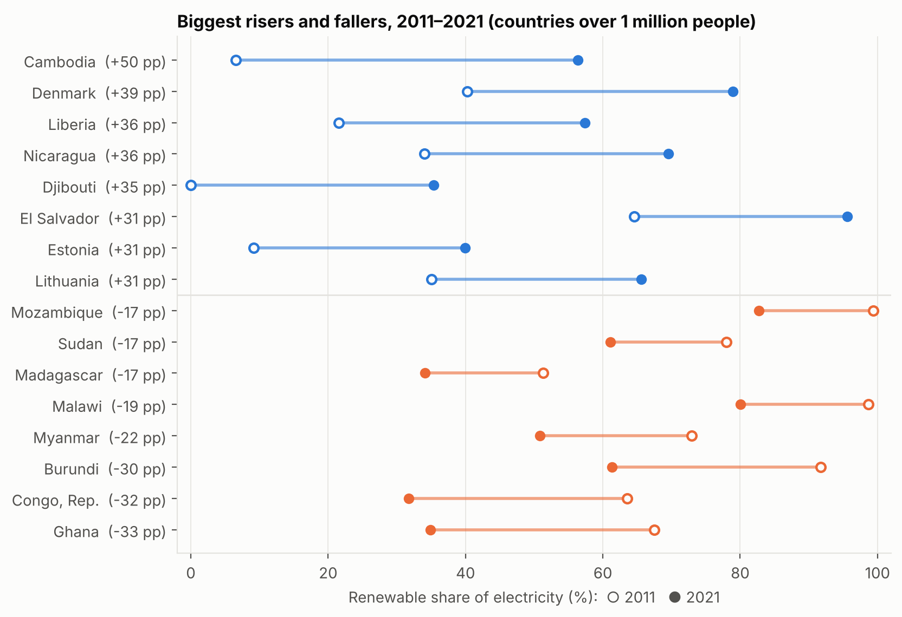
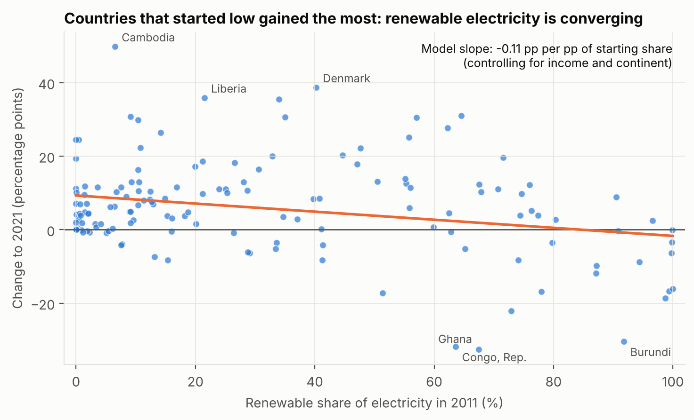

<picture>
  <source media="(prefers-color-scheme: dark)" srcset="assets/header-energy-dark.svg">
  
</picture>

[](https://github.com/sahiljangra12/energy-transition-analysis/actions/workflows/ci.yml)

How has renewable energy grown across countries since 2000, and how does it relate to national income? This project uses World Bank and UN SDG 7.2.1 data for 215 countries and areas. It runs from raw API responses to tested results, static figures and an interactive dashboard.

**[Open the interactive dashboard →](https://sahiljangra12.github.io/energy-transition-analysis/)** · [Research note](docs/report.md) · [Data dictionary](docs/data_dictionary.md)

## Key findings

**1. Renewable electricity has doubled for the typical country, more than the headline median suggests.** The set of reporting countries changes over time, which drags the raw median around (it drops in 2000 only because 62 more countries start reporting). Holding the same 187 countries fixed, the median renewable share of electricity rose from **10.3% in 2000 to 22.0% in 2021**.



**2. "Renewable share" tells two different stories about income.** For all final energy, the renewable share falls steeply with income (ρ = −0.56): poorer countries rely on traditional biomass. For electricity, the link is weak (ρ = −0.17), because rich countries range from almost no renewables to almost all hydro and wind.



| GDP per capita quartile, 2021 | Median GDP per capita | Renewable share of electricity | Renewable share of all final energy |
|---|---|---|---|
| Q1 (poorest) | $1,201 | 44% | 65% |
| Q2 | $4,287 | 24% | 19% |
| Q3 | $12,748 | 19% | 13% |
| Q4 (richest) | $43,725 | 23% | 12% |

**3. Three in four countries moved up between 2011 and 2021, but some hydro-dependent ones fell sharply.** Among the 151 countries with more than 1 million people, 74% increased their renewable electricity share, with a median rise of +4.6 percentage points. Cambodia (+50 pp) and Denmark (+39 pp) rose the most, while Ghana (−33 pp) and the Republic of Congo (−32 pp) fell the most.



**4. Low-share countries are catching up, and that holds after controlling for income and region.** In a regression of each country's 2011–2021 change on its 2011 share, log GDP per capita and continent, every 10 points of starting share means about 1.1 points less growth (p < 0.001, n = 149). Once that is accounted for, income has no effect on the rate of change. European countries gained about 13 points more than comparable African countries.



| Model (robust standard errors) | Key coefficient | Estimate | p-value | n |
|---|---|---|---|---|
| Electricity share, 2021, on income, population and continent | log GDP per capita | −6.6 pp | 0.002 | 197 |
| Final-energy share, 2021, same controls | log GDP per capita | −9.2 pp | <0.001 | 205 |
| Change 2011–2021, on starting share, income and continent | Starting share | −0.11 | <0.001 | 149 |
| Electricity share, 2000–2021, country and year fixed effects | log GDP per capita | −2.5 pp | 0.11 | 4,312 |

Two more points from the models. Within a country, rising income is not significantly linked to a changing renewable share (the fixed-effects model). And income, population and continent together explain only 15% of the cross-country variation in renewable electricity, compared with 49% for final energy: electricity depends mainly on things not in this data, such as hydro resources and policy. Full coefficients are in [`results/model_coefficients.csv`](results/model_coefficients.csv).

All results, including the models, are associations, not causal effects. Limitations are listed in the [research note](docs/report.md#limitations).

## Method

1. **Raw data:** the original API responses are stored unchanged in `data/raw/`, gzipped.
2. **Clean:** only countries are kept. World Bank rows are matched to ISO 3166 alpha-3 codes and UN rows to ISO numeric codes, which removes every regional and income aggregate. The result is a country-year panel.
3. **Analyse:** the trend is measured three ways (median of all reporting countries, median of a balanced panel, population-weighted mean). The pipeline also computes income-quartile comparisons, Spearman correlations with GDP per capita, and 2011–2021 changes for countries with at least 1 million people.
4. **Model:** OLS regressions with heteroskedasticity-robust (HC3) standard errors: a 2021 cross-section of renewable shares on log income, log population and continent; a convergence model of 2011–2021 change on starting share; and a country and year fixed-effects panel with errors clustered by country.
5. **Publish:** it writes CSV results, static figures and a self-contained dashboard served by GitHub Pages.

## Repository

```
src/energy_transition/   build.py (raw → clean) · analysis.py · models.py · figures.py · dashboard.py
data/raw/                World Bank and UN API responses (gzipped, unchanged)
data/clean/              Country panel tables used by the analysis
results/                 summary.json and one CSV per table
figures/                 Static figures
docs/                    Interactive dashboard (index.html), research note, data dictionary
app.py                   Streamlit explorer
tests/                   Data and results checks
```

## Reproduce

```bash
pip install -e ".[dev]"
python -m energy_transition      # rebuilds data/clean, results, figures and the dashboard
pytest                           # checks the data and headline numbers

pip install -e ".[app]"
streamlit run app.py             # optional local explorer
```

On every push, continuous integration lints the code and runs the tests. It then rebuilds everything from the raw data and fails if any committed result changes.

## Sources

- World Bank Indicators API: [EG.ELC.RNEW.ZS](https://data.worldbank.org/indicator/EG.ELC.RNEW.ZS), [EG.FEC.RNEW.ZS](https://data.worldbank.org/indicator/EG.FEC.RNEW.ZS), [NY.GDP.PCAP.CD](https://data.worldbank.org/indicator/NY.GDP.PCAP.CD), [SP.POP.TOTL](https://data.worldbank.org/indicator/SP.POP.TOTL)
- UN SDG Global Database, [indicator 7.2.1](https://unstats.un.org/sdgs/metadata/files/Metadata-07-02-01.pdf)

Code is released under the MIT License. The data remain subject to the World Bank and UN terms of use.
